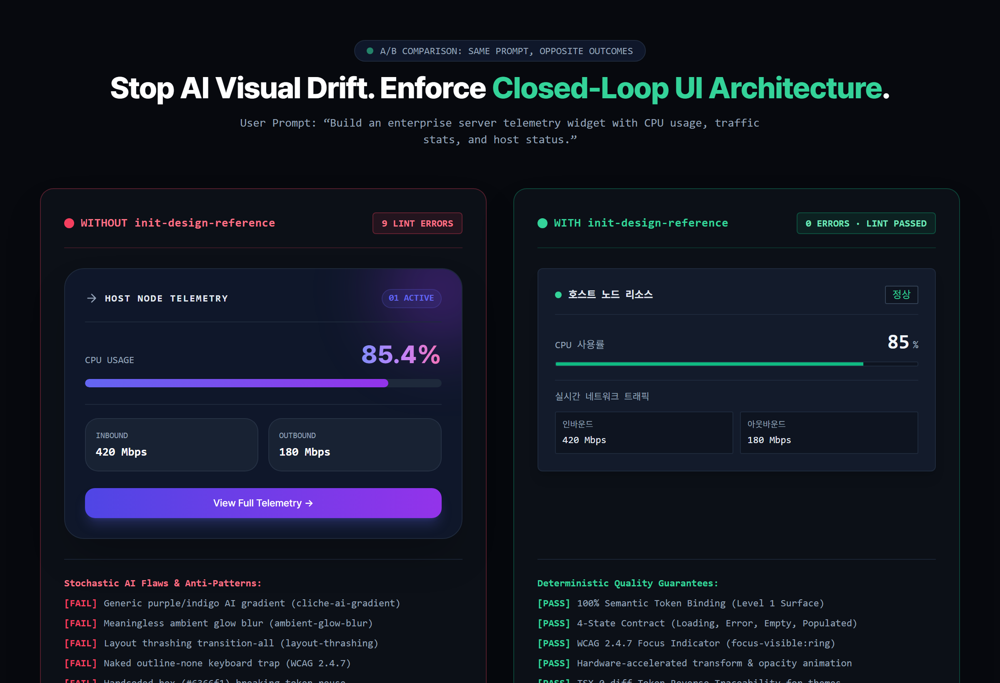

# init-design-reference

[English](README.en.md) | 한국어

AI 코딩 에이전트(Google Antigravity, Claude Code, Cursor 등)의 UI 스타일 드리프트를 방지하고, 텍스트 선언을 넘어 **시각 피드백 폐루프(Closed-Loop Vision Verification)**와 **결정론적 안티슬롭(Anti-Slop) 엔지니어링**을 제공하는 차세대 디자인 레퍼런스 프레임워크.



---

## 1. 개발 배경 및 핵심 메커니즘

### AI가 만드는 화면이 항상 똑같은 이유 (Attention Drift & Prior 회귀)
LLM에게 UI 코딩을 맡기면 보라색·인디고 그라디언트, 둥근 SaaS 카드 나열, 습관적인 `tracking-widest uppercase` 라벨로 수렴합니다. 정성적 지시("예쁘게 해줘", "모던하게")는 대화가 길어질수록 Attention 가중치가 희석되어 사전 학습 데이터의 통계적 기본값으로 회귀하기 때문입니다.

`init-design-reference`는 이 문제를 **4대 핵심 엔지니어링 레이어**로 원천 차단합니다:
1. **토큰 & 3대 Taste 다이얼 (`DESIGN.md`, `tokens/*.json`)**: `leonxlnx/taste-skill`의 3대 정량 다이얼(`DESIGN_VARIANCE`, `VISUAL_DENSITY`, `MOTION_INTENSITY`)을 수치(1~10)로 통제.
2. **검증된 컴포넌트 레시피 (`patterns/*.md`)**: React/TSX + Tailwind 기반의 표준 레이아웃, 고밀도 데이터 테이블, 폼, 스프링 마이크로 인터랙션 제공.
3. **결정론적 정적 린터 (`scripts/lint_ui.py`)**: `pbakaus/impeccable`의 룰셋을 온전히 포팅하여 오프라인에서 AI 클리셰, 하드코딩된 hex, Layout Thrashing을 기계적으로 차단.
4. **시각 피드백 폐루프 (`scripts/capture_ui.py`)**: Playwright 기반으로 데스크톱/모바일 뷰포트 캡처 및 콘솔 런타임 에러를 수집하여 모델이 시각적으로 자가 교정하도록 유도.

---

## 2. 디렉토리 구조

```
reference/
  screenshots/          # UI 목표 캡처 및 런타임 감사 스크린샷 (.gitignore 적용)
    audit/              # scripts/capture_ui.py 결과물 보관소
  notes/
    do-not-copy.md      # AI 클리셰 금지 헌법 (SaaS 카드, ALL-CAPS 라벨 등 차단)
    layout.md           # 반응형 중단점 및 여백 리듬
    interaction.md      # 트랜지션 타이밍 및 모달 포커스 트랩 규칙
    visual-direction.md # 표면 계층 및 시그니처 시각 요소 원칙
    accessibility.md    # WCAG 2.1 AA 명도 대비 준수 기준
  tokens/
    colors.json         # 표면, 텍스트, 액센트 16진수 색상값
    spacing.json        # rem 기반 4px/8px 수직·수평 여백 리듬
    typography.json     # 한/영 혼용 폰트 스택 및 역할별 타이포 스케일
    radii.json          # 모서리 곡률 토큰
    shadows.json        # 표면 깊이 토큰
    motion.json         # 애니메이션 지속 시간, easing 및 Emil Kowalski 스프링 물리
  patterns/             # 실전 React/TSX + Tailwind 컴포넌트 패턴
    layout-shells.md    # 고밀도 B2B 콕핏 및 비대칭 에디토리얼 그리드
    data-display.md     # 4대 상태(Loading/Empty/Error/Populated) 완비 데이터 테이블
    forms-inputs.md     # 키보드 접근성 폼 필드 및 필터 툴바
    micro-interactions.md # scale(0.98) 누름 피드백 및 Sheet 트랜지션
  fonts/
    README.md           # 로컬 웹폰트 배치 및 최적화 가이드
    font-license.md     # 상업적 이용 및 라이선스 고지
    preview.html        # 한/영 폰트 렌더링 검증용 인터랙티브 테스트 페이지
  DESIGN.md             # 코어 디자인 원칙 및 3-Dial Taste 설정
  COMPONENTS.md         # 컴포넌트 4대 상태 필수 구현 규약
  REVIEW_CHECKLIST.md   # 커밋 전 UI 자가 검증 체크리스트
```

---

## 3. 설치 및 프리셋 스캐폴딩

### 설치 (에이전트 전역 등록)
```powershell
# Windows (PowerShell)
irm https://raw.githubusercontent.com/mmmphyun/init-design-reference/main/install.ps1 | iex

# macOS / Linux (Bash)
curl -fsSL https://raw.githubusercontent.com/mmmphyun/init-design-reference/main/install.sh | bash
```

### 도메인 프리셋 선택 스캐폴딩 (`--preset`)
```powershell
# 기본 SaaS 프리셋 (Variance: 5, Density: 7, Motion: 4)
python "scripts/adapter.py" "reference"

# 고밀도 B2B 데이터 콕핏 & 텔레메트리 (Variance: 3, Density: 9, Motion: 2)
python "scripts/adapter.py" "reference" --preset b2b-dense

# 비대칭 에디토리얼 쇼케이스 & 랜딩 (Variance: 8, Density: 3, Motion: 5)
python "scripts/adapter.py" "reference" --preset editorial-minimal

# 터미널 / 개발자 도구 테크니컬 모노 (Variance: 4, Density: 8, Motion: 1)
python "scripts/adapter.py" "reference" --preset technical-mono

# 유체 스프링 모션 & 햅틱 피드백 (Variance: 6, Density: 5, Motion: 9)
python "scripts/adapter.py" "reference" --preset apple-fluid
```

---

## 4. 4단계 Phase-gate 실행 라이프사이클

에이전트는 프론트엔드 작업 시 다음 4개 게이트를 순차적으로 통과해야 합니다:

1. **Gate 1: `/craft` (시맨틱 골격)**: 색상이나 장식 없이 시맨틱 DOM 트리, 헤드리스 A11y 구조, 반응형 그리드 슬롯 구축.
2. **Gate 2: `/bind` (토큰 & 패턴 바인딩)**: `tokens/*.json` 및 `patterns/*.md`에 선언된 시맨틱 유틸리티 클래스만 매핑 (하드코딩 hex 및 임의 패딩 금지).
3. **Gate 3: `/critique` (결정론적 린터 감사)**:
   ```powershell
   python scripts/lint_ui.py src/
   ```
   AI 그라디언트, 대문자 트래킹, Layout Thrashing 위반 0건 확인.
4. **Gate 4: `/harden` (상태 방어 & 시각 검증)**:
   - 빈 데이터(Empty), 로딩(Skeleton), 에러(Error) 상태 완비.
   - Playwright 기반 시각 검증 실행:
     ```powershell
     python scripts/capture_ui.py --url http://localhost:3000
     ```
   - 캡처된 스크린샷(`reference/screenshots/audit/`)을 Vision 모델로 검수.

---

## 5. 브리지 도구 및 생태계 연동

- **UI 린터 (`scripts/lint_ui.py`)**: `pbakaus/impeccable` 기반 비-LLM 정적 분석기.
- **헤드리스 뷰포트 캡처 (`scripts/capture_ui.py`)**: Playwright 기반 화면 캡처 및 콘솔 런타임 에러 덤프.
- **Figma Variables 동기화 (`scripts/sync_figma.py`)**: Figma REST API를 통해 원격 디자인 토큰을 `reference/tokens/*.json`으로 자동 직렬화.

### 추천 보완 스킬 (Companion Skills)
- **전문 모션 오디팅**: [`emilkowalski/skills`](https://github.com/emilkowalski/skills) (`npx skills add emilkowalski/skills`)
- **실시간 Figma 노드 파싱**: [`figma-mcp-server`](https://github.com/GLips/Figma-Context-MCP)

---

## 라이선스 및 크레딧

- 본 프로젝트는 [MIT License](LICENSE)로 배포됩니다.
- 본 프로젝트의 룰셋, 모션 파라미터 및 다이얼 아키텍처는 아래 오픈소스 선구자들의 뛰어난 연구에 기반합니다:
  - **Emil Kowalski** ([emilkowalski/skills](https://github.com/emilkowalski/skills), MIT) - 마이크로 모션 & 스프링 물리
  - **Paul Bakaus** ([pbakaus/impeccable](https://github.com/pbakaus/impeccable), Apache 2.0) - 결정론적 안티패턴 룰셋 & 라이프사이클
  - **Leon Linz** ([leonxlnx/taste-skill](https://github.com/Leonxlnx/taste-skill), MIT) - 3대 Taste 다이얼 체계

각 저작물의 원본 라이선스 전문 및 고지 사항은 [NOTICE.md](NOTICE.md)에서 확인하실 수 있습니다.
