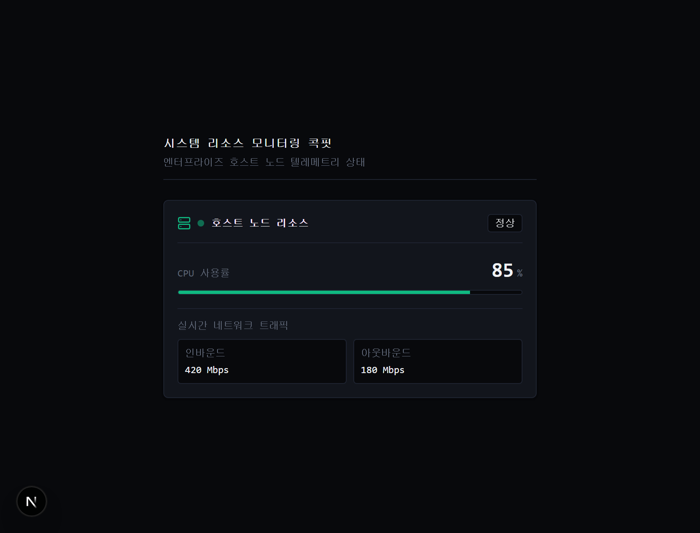
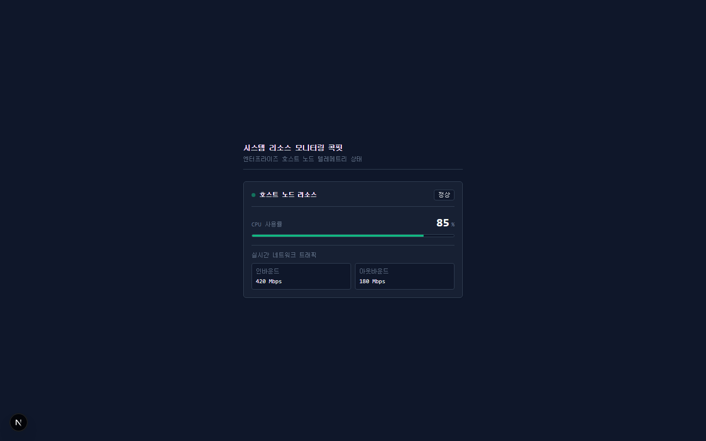

# init-design-reference

[English](README.en.md) | 한국어

AI 코딩 에이전트(Google Antigravity, Claude Code, Cursor 등)의 UI 스타일 드리프트를 방지하고, 텍스트 프롬프트를 넘어 **결정론적 안티슬롭(Anti-Slop) 린터**와 **시각 피드백 폐루프(Closed-Loop Vision Verification)**를 제공하는 차세대 디자인 엔지니어링 프레임워크.

---

## 1. 실측 엔지니어링 증거 (Real-World Proof)

### ① TSX 0-diff 토큰 역추적 시각 변경 실측 (Next.js 15 App Router)
컴포넌트 TSX 코드를 단 1줄도 수정하지 않고(0-diff), `.design/tokens/colors.json` 수정 및 CSS 브리지 재생성만으로 실제 프로덕션 렌더링이 변경됨을 헤드리스 Playwright로 실측 검증했습니다.

| 기준 렌더링 (`assets/baseline.png`) | 토큰 갱신 렌더링 (`assets/updated.png`) |
|:---:|:---:|
|  |  |
| `--surface`: `#12151c` (Cockpit Carbon)<br>`--accent`: `#10b981` (Phosphor Emerald) | `--surface`: `#171717` (Terminal Panel)<br>`--accent`: `#f59e0b` (Amber Phosphor CRT) |

```console
$ git diff --stat app/components/MetricCard.tsx
# 0 files changed, 0 insertions(+), 0 deletions(-) -> 완전한 0-diff 달성
```

---

### ② 결정론적 정적 린터 & 자가 치유(Self-Healing) 실측
정규식 기반의 경량 정적 린터(`scripts/lint_ui.py`)로 접근성 결함과 하드코딩된 토큰을 감지하고, 에이전트가 코드를 스스로 수정하여 `0 errors`로 수렴합니다.

```console
$ python scripts/lint_ui.py app/components/MetricCard.tsx

--- UI Lint Findings ---
[ERROR] app/components/MetricCard.tsx:71 (a11y-naked-outline-none)
       outline-none detected on element without focus-visible:ring replacement (WCAG 2.4.7).
[ERROR] app/components/MetricCard.tsx:102 (hardcoded-hex)
       Hardcoded hex color detected (#1e293b). Use semantic tokens from colors.json.
[WARN]  app/components/MetricCard.tsx:102 (layout-thrashing-animation)
       Layout thrashing animation detected (transition-all). Animate ONLY transform and opacity.
[ERROR] app/components/MetricCard.tsx:105 (a11y-missing-alt)
        tag missing alt attribute (WCAG 1.1.1).
[WARN]  app/components/MetricCard.tsx:107 (cliche-tracking-uppercase)
       Generic AI 'uppercase tracking-widest' eyebrow label detected.

Scan complete: 1 files inspected. Findings: 3 errors, 2 warnings.
Lint FAILED. Rectify errors or align with reference/ tokens and patterns.

# -> 에이전트 자가 치유(Self-Healing) 루프 1회 통과 후:
$ python scripts/lint_ui.py app/components/MetricCard.tsx
Scan complete: 1 files inspected. Findings: 0 errors, 2 warnings.
Lint PASSED.
```

---

### ③ 디자인 스펙 정적 하드가드 (`--verify-spec`)
필수 디자인 토큰이나 Taste 다이얼 설정(1~10 범위, 유효 hex 포맷)의 결함을 정적으로 검증하여 스펙 오류 전파를 차단합니다. 에이전트의 사용자 승인 완료 후 코드 생성 직전에 실행되어 설정 무결성을 보장합니다.


```console
$ python scripts/adapter.py --verify-spec
[HARD-GUARD FAIL] .design\DESIGN.md is missing one of DESIGN_VARIANCE, VISUAL_DENSITY, MOTION_INTENSITY.
# -> 에이전트의 무지성 코딩 진입을 원천 차단하고 스펙 정상화 후 재진행 강제
```

---

## 2. 개발 배경 및 핵심 메커니즘

### AI가 만드는 화면이 항상 똑같은 이유 (Attention Drift & Prior 회귀)
LLM에게 프론트엔드 코딩을 맡기면 보라색·인디고 그라디언트, 둥근 SaaS 카드 나열, 습관적인 `tracking-widest uppercase` 라벨로 수렴합니다. 정성적 지시("예쁘게 해줘", "모던하게")는 대화가 길어질수록 Attention 가중치가 희석되어 사전 학습 데이터의 통계적 기본값(Slop)으로 회귀하기 때문입니다.

`init-design-reference`는 이 문제를 **4대 핵심 엔지니어링 레이어**로 원천 차단합니다:
1. **토큰 & 3대 Taste 다이얼 (`DESIGN.md`, `.design/tokens/*.json`)**: `leonxlnx/taste-skill`의 3대 정량 다이얼(`DESIGN_VARIANCE`, `VISUAL_DENSITY`, `MOTION_INTENSITY`)을 수치(1~10)로 통제.
2. **검증된 컴포넌트 레시피 (`.design/patterns/*.md`)**: React/TSX + Tailwind 기반의 표준 레이아웃, 데이터 테이블, 폼, 스프링 마이크로 인터랙션 제공.
3. **결정론적 정적 린터 (`scripts/lint_ui.py`)**: `pbakaus/impeccable`의 패턴 검출 철학을 정규식 기반으로 구현하여 접근성 결함(WCAG)과 하드코딩된 토큰을 오프라인에서 기계적으로 차단.
4. **시각 피드백 폐루프 (`scripts/capture_ui.py`)**: Playwright 기반으로 뷰포트 캡처 및 콘솔 런타임 에러를 수집하여 모델이 시각적으로 자가 교정하도록 유도.

---

## 3. 디렉토리 구조 (.design 골디락스 아키텍처)

```
.design/                # 프로젝트 런타임 디자인 저장소 (레거시 reference/ 투명 폴백 지원)
  screenshots/          # UI 목표 캡처 및 런타임 감사 스크린샷 (.gitignore 적용)
    audit/              # scripts/capture_ui.py 결과물 보관소
  tokens/               # 프로젝트 런타임에 직접 보존되는 디자인 토큰
    colors.json         # 표면, 텍스트, 액센트 16진수 색상값
    spacing.json        # rem 기반 4px/8px 수직·수평 여백 리듬
    typography.json     # 한/영 혼용 폰트 스택 및 공식 CDN 링크
    radii.json          # 모서리 곡률 토큰
    shadows.json        # 표면 깊이 토큰 (Meng To 앰비언트 오클루전)
    motion.json         # 애니메이션 지속 시간 및 Emil Kowalski 스프링 물리 계수
    theme.css           # 런타임 CSS 브리지 (Tailwind v4 / Vanilla CSS)
    tailwind.preset.js  # 런타임 프리셋 브리지 (Tailwind v3)
  patterns/             # 프로덕션 React/TSX + Tailwind 컴포넌트 패턴
    layout-shells.md    # 고밀도 B2B 콕핏 및 비대칭 에디토리얼 그리드
    data-display.md     # 4대 상태(Loading/Empty/Error/Populated) 완비 데이터 테이블
    forms-inputs.md     # 키보드 접근성 폼 필드 및 필터 툴바
    micro-interactions.md # scale(0.98) 누름 피드백 및 스프링 물리학
  DESIGN.md             # 코어 디자인 헌법 및 3-Dial Taste 설정
```

> **Zero Repo Pollution**: 정적 가이드라인 문서(`notes/*.md`, `REVIEW_CHECKLIST.md` 등)는 전역 스킬 내부에 격리 보존되어 레포지토리를 오염시키지 않으며, 에이전트가 JIT 방식으로 참조합니다.

---

## 4. 설치 및 프리셋 스캐폴딩

### 설치 (에이전트 전역 등록)
```powershell
# Windows (PowerShell)
irm https://raw.githubusercontent.com/mmmphyun/init-design-reference/main/install.ps1 | iex

# macOS / Linux (Bash)
curl -fsSL https://raw.githubusercontent.com/mmmphyun/init-design-reference/main/install.sh | bash
```

### 도메인 프리셋 선택 스캐폴딩 (`--preset`)
```powershell
# 기본 SaaS baseline (Variance: 5, Density: 7, Motion: 4)
python "scripts/adapter.py"

# 고밀도 B2B 데이터 콕핏 & 텔레메트리 (Variance: 3, Density: 9, Motion: 2)
python "scripts/adapter.py" --preset b2b-dense

# 비대칭 에디토리얼 쇼케이스 & 랜딩 (Variance: 8, Density: 3, Motion: 5)
python "scripts/adapter.py" --preset editorial-minimal

# 터미널 / 개발자 도구 테크니컬 모노 (Variance: 4, Density: 8, Motion: 1)
python "scripts/adapter.py" --preset technical-mono

# 유체 스프링 모션 & 햅틱 피드백 (Variance: 6, Density: 5, Motion: 9)
python "scripts/adapter.py" --preset apple-fluid
```

---

## 5. 자율 주행 5-Gate 오케스트레이션 루프

에이전트는 프론트엔드 작업 시 다음 게이트 파이프라인을 기계적으로 준수합니다:

1. **Gate 0: Smart Alignment (High-Touch Dialog & Hard-Guard)**:
   - 기존 프로젝트 정체성 파악 및 6-Decision Matrix 추적 (확인 / 프로젝트 추출 / 미정 / 가정).
   - Adaptive Deep Probe를 통해 합의된 Taste 3-다이얼(1~10) 및 브랜드 토큰 동적 합성.
   - **사용자 승인 락(Strict Lock)**: 사용자 명시 승인 전까지 파일 작성 및 `adapter.py` 실행 금지.
   - `python scripts/adapter.py --verify-spec` 하드가드 통과 검증 (다이얼 범위 1~10 및 필수 토큰 유효성).
2. **Phase 1: Semantic Skeleton (Craft)**: 색상이나 장식 없이 시맨틱 DOM 트리, 접근성(ARIA) 구조, 반응형 그리드 구축.
3. **Phase 2: Token & Surface Binding (Bind)**: `.design/tokens/*.json` 시맨틱 유틸리티 클래스 매핑 (하드코딩 hex 및 임의 Tailwind 색상 금지).
4. **Phase 3: Deterministic Lint & Self-Healing (Critique)**:
   ```powershell
   python scripts/lint_ui.py src/
   ```
   객관적 오류(`[ERROR]`, A11y 및 토큰 누락) 발생 시 에이전트가 코드를 스스로 수정하여 3회 이내 `0 errors` 달성.
5. **Phase 4: Completeness & Vision Verification (Harden)**:
   - 비동기 데이터 뷰에 한하여 빈 데이터(Empty), 로딩(Skeleton), 에러(Error), 정상(Populated) 4-State 구현.
   - Playwright 기반 시각 검증 실행 및 캡처:
     ```powershell
     python scripts/capture_ui.py
     ```
   - 사용자 피드백 시 스타일(색상·간격·폰트)은 `tokens/*.json`으로 역추적하고, 컴포넌트 구조 변경은 TSX 코드를 수정하여 정밀 반영.

---

## 라이선스 및 크레딧

- 본 프로젝트는 [MIT License](LICENSE)로 배포됩니다.
- 본 프로젝트의 룰셋, 모션 파라미터 및 다이얼 아키텍처는 아래 오픈소스 선구자들의 뛰어난 연구에 기반합니다:
  - **Emil Kowalski** ([emilkowalski/skills](https://github.com/emilkowalski/skills), MIT) - 마이크로 모션 & 스프링 물리
  - **Paul Bakaus** ([pbakaus/impeccable](https://github.com/pbakaus/impeccable), Apache 2.0) - 결정론적 안티패턴 룰셋 & 라이프사이클
  - **Leon Linz** ([leonxlnx/taste-skill](https://github.com/Leonxlnx/taste-skill), MIT) - 3대 Taste 다이얼 체계
  - **Addy Osmani** - 접근성 및 시맨틱 웹 표준 규약

각 저작물의 원본 라이선스 전문 및 고지 사항은 [NOTICE.md](NOTICE.md)에서 확인하실 수 있습니다.
